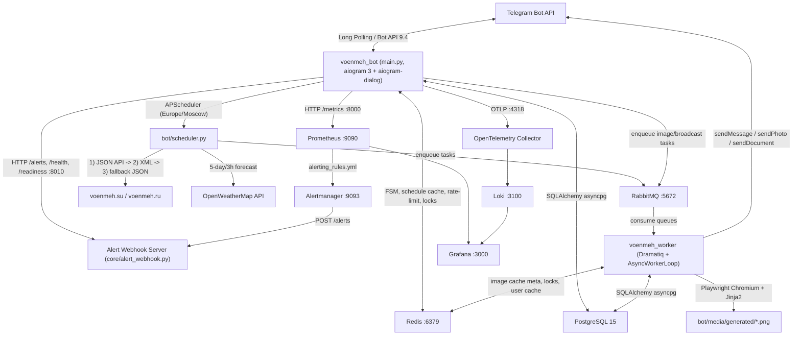

# Архитектура Voenmeh Timetable Bot

Документ описывает архитектуру, потоки данных, схему базы данных, фоновые сервисы, рендеринг изображений, стек наблюдаемости и процессы развёртывания Telegram-бота расписания БГТУ «ВОЕНМЕХ» им. Д.Ф. Устинова.

---

## 1. Общая схема системы

---

## 2. Сервисы Docker Compose

| Сервис | Контейнер | Профиль | Назначение |
|---|---|---|---|
| `migrate` | `voenmeh_migrate` | default | Применяет миграции Alembic (`python -m core.db.migrate`) до старта `bot` и `worker` |
| `bot` | `voenmeh_bot` | default | Основной процесс Telegram-бота, APScheduler, Prometheus `:8000`, health/alert webhook `:8010` |
| `worker` | `voenmeh_worker` | default | Воркеры Dramatiq (`--processes 2 --threads 4`) для рассылок, напоминаний и рендеринга картинок |
| `db` | `voenmeh_postgres` | default | PostgreSQL 15 Alpine с часовым поясом `Europe/Moscow` |
| `redis` | `voenmeh_redis` | default | Redis 7 Alpine (FSM-хранилище, кэш расписания, rate-limit, блокировки, метаданные кэша) |
| `rabbitmq` | `voenmeh_rabbitmq` | default | Брокер очередей Dramatiq (`high_priority`, `medium_priority`, `low_priority`, `default`) |
| `prometheus` | `voenmeh_prometheus` | `monitoring` | Сбор метрик бота и узла, оценка `prometheus/alerting_rules.yml` |
| `alertmanager` | `voenmeh_alertmanager` | `monitoring` | Маршрутизация алертов в `http://bot:8010/alerts` |
| `grafana` | `voenmeh_grafana` | `monitoring` | Дашборды `bot_dashboard.json` и `user_activity_dashboard.json` |
| `loki` / `promtail` | `voenmeh_loki` / `voenmeh_promtail` | `monitoring` | Централизованный сбор JSON-логов контейнеров |
| `otel-collector` | `voenmeh_otel_collector` | `monitoring` | Приём OTLP-трейсов/логов/метрик (`:4317`, `:4318`) |
| `node-exporter` | `voenmeh_node_exporter` | `monitoring` | Системные метрики хоста |
| `pgadmin` | `voenmeh_pgadmin` | `tools` | Веб-интерфейс администрирования PostgreSQL (`127.0.0.1:5050`) |

---

## 3. Жизненный цикл и цепочка Middleware (`main.py`)

### 3.1. Инициализация
1. `setup_logging()` — настраивает JSON-логирование (`python-json-logger`) и при `OTEL_ENABLED=true` подключает OpenTelemetry (`core/telemetry.py`).
2. `load_dotenv()` и валидация `BOT_TOKEN`, `REDIS_URL`, `DATABASE_URL`.
3. `TimetableManager.create(redis_client)` — распределённая блокировка `timetable_init_lock` и многоуровневая загрузка расписания:
   - Redis кэш (`REDIS_SCHEDULE_CACHE_KEY`, gzip-сжатый JSON);
   - Парсинг с источника (`voenmeh.su` JSON API → fallback на `voenmeh.ru` XML);
   - Восстановление из последней резервной копии в Redis (`timetable:backup:*`);
   - Локальный аварийный файл `data/fallback_schedule.json`.
4. `UserDataManager.init_db()` — проверка схемы БД (`assert_schema_current`) и инициализация пула SQLAlchemy (`asyncpg`).
5. `SemesterSettingsManager` — подключение настраиваемых дат начала осеннего/весеннего семестров к `TimetableManager`.
6. Создание `Bot` с `FastConnectAiohttpSession` (IPv4-only, быстрый `sock_connect`) и request-middleware:
   - `CustomEmojiRequestMiddleware` — подстановка `<tg-emoji>` и `icon_custom_emoji_id` / `style` (Bot API 9.4);
   - `NetworkRetryRequestMiddleware` — ретраи при `TelegramNetworkError` (с защитой от дублирования non-idempotent `send*` при read timeout).
7. Регистрация роутеров, диалогов (`aiogram-dialog`), планировщика (`APScheduler`), HTTP-сервера метрик (`:8000`), HTTP-сервера health/alerts (`:8010`) и бизнес-мониторинга.
8. Корректное завершение в `finally:`: отмена фоновых задач, `alert_runner.cleanup()`, `scheduler.shutdown()`, закрытие `dp.storage`, `bot.session`, `user_data_manager.close()` (БД + Redis), `shutdown_image_generator()` (Playwright/Chromium) и `shutdown_telemetry()`.

### 3.2. Порядок Update Middleware (`dp.update.middleware`)
1. `RateLimitMiddleware` — анти-флуд (sliding window в Redis) до обращений к БД и телеметрии.
2. `ManagerMiddleware` — внедрение актуального `TimetableManager` (с поддержкой hot-swap через `TimetableManagerRef`).
3. `UserDataMiddleware` — внедрение `UserDataManager`, регистрация/обновление `last_active_date` и `data["user_info"]`.
4. `SessionMiddleware` — внедрение `session_factory` (`async_sessionmaker`).
5. `ActivityLoggingMiddleware` — структурированное логирование активности и Prometheus-метрики.
6. `LoggingMiddleware` — трассировка OpenTelemetry (`aiogram.event`) и метрики `EVENTS_PROCESSED` / `HANDLER_DURATION`.
7. `I18nMiddleware` — определение языка (`ru` / `en` / `zh`) из `user_info.language` или `from_user.language_code`.
8. Контекстная lambda — внедрение `bot`, `scheduler`, `redis_client`.
9. `SubscriptionFilterMiddleware` — проверка обязательной подписки на каналы из БД (`RequiredChannel`).
10. Inner guard `AdminDialogGuardMiddleware` (`dp.message` / `dp.callback_query`) — блокировка состояний `AdminSG` для не-администраторов.

---

## 4. Схема базы данных (`core/db/models.py`)

Все временные метки в БД хранятся в **naive `Europe/Moscow`** (см. `core/time_utils.py:now_msk_naive()`), а сессия PostgreSQL настраивается на `timezone=Europe/Moscow`.

| Таблица | Модель | Ключевые поля | Назначение |
|---|---|---|---|
| `users` | `User` | `user_id` (PK), `username`, `group`, `user_type`, `language`, `theme`, `evening_notify`, `morning_summary`, `lesson_reminders`, `schedule_diff_notify`, `morning_time`, `evening_time`, `reminder_time_minutes`, `is_blocked`, `blocked_date`, `registration_date`, `last_active_date` | Профили студентов/преподавателей и персональные настройки уведомлений |
| `semester_settings` | `SemesterSettings` | `id`, `fall_semester_start`, `spring_semester_start`, `updated_at`, `updated_by` | Настраиваемые даты старта осеннего/весеннего семестров |
| `feedback` | `Feedback` | `id`, `user_id`, `username`, `user_full_name`, `message_text`, `message_type`, `file_id`, `is_answered`, `admin_response`, `answered_by`, `created_at`, `answered_at` | Тикеты обратной связи и ответы администраторов |
| `schedule_change_logs` | `ScheduleChangeLog` | `id`, `target_name`, `target_type`, `schedule_date`, `change_type`, `lesson_time`, `subject`, `old_value`, `new_value`, `created_at` | Аудит-лог всех обнаруженных изменений расписания |
| `failed_messages` | `FailedMessage` | `id`, `user_id`, `message_type`, `payload`, `error_message`, `retry_count`, `status`, `created_at`, `updated_at` | Dead-Letter Queue (DLQ) для недоставленных рассылок |
| `subscription_filter_settings` | `SubscriptionFilterSetting` | `id`, `is_enabled`, `updated_at`, `updated_by` | Глобальный флаг включения фильтра обязательной подписки |
| `required_channels` | `RequiredChannel` | `id`, `channel_id` (unique), `title`, `invite_link`, `created_at` | Список каналов для обязательной подписки |
| `user_lesson_rules` | `UserLessonRule` | `id`, `user_id`, `rule_type`, `target_group`, `week_key`, `day_name`, `start_time`, `subject`, `payload`, `created_at` | Персональные правила пользователей (`hide_subject`, `note`, `custom_lesson`) |
| `group_chats` | `GroupChat` | `chat_id` (PK), `title`, `target_group`, `language`, `morning_summary`, `evening_notify`, `lesson_reminders`, `schedule_diff_notify`, `morning_time`, `evening_time`, `reminder_time_minutes`, `is_active`, `added_by_user_id` | Режим рассылок в групповых чатах и супергруппах |

Миграции управляются через **Alembic** (`migrations/versions/`). Тест `tests/regression/test_migrations.py` гарантирует единую ветку миграций (ровно один `head`) и длину revision ID ≤ 32 символов.

---

## 5. Очереди задач и планировщик

### 5.1. APScheduler (`bot/scheduler.py`)
Работает внутри процесса `bot` в часовом поясе `Europe/Moscow`:
- **Каждую минуту (`*`)**:
  - `evening_broadcast` — вечерняя сводка на завтра (для пользователей и групповых чатов с совпадающим `evening_time`), с прогнозом погоды (`WeatherAPI` + `summary_advisor`) и применением `UserLessonRule`;
  - `morning_summary_broadcast` — утренняя сводка на сегодня (по `morning_time`);
  - `minutely_reminders_checker` — напоминания о первой паре (за `reminder_time_minutes`), о переменах и окончании учебного дня.
- **Каждые `CHECK_INTERVAL_MINUTES` (по умолчанию 30 мин)**:
  - `monitor_schedule_changes` — парсинг расписания, сравнение хэшей, hot-swap `TimetableManager`, вычисление диффов (`ScheduleDiffDetector`), запись в `ScheduleChangeLog`, точечная инвалидация кэша изображений для изменённых групп и постановка уведомлений в очередь.
- **Ежедневно / еженедельно / ежемесячно**:
  - `handle_graduated_groups` (04:00) — двухэтапная проверка выпустившихся групп через Redis-счётчик пропусков;
  - `backup_current_schedule` (03:00) — снапшот расписания в Redis и `data/fallback_schedule.json`;
  - `auto_backup` — регулярный SQL-дамп PostgreSQL (`core/db/backups.py`) с gzip-сжатием и отправкой в `BACKUP_CHAT_ID`;
  - `cleanup_image_cache` (02:00) — очистка устаревших картинок (`ImageCacheManager`);
  - `collect_db_metrics` (каждые 5 мин) — обновление Prometheus-метрик БД и системы;
  - `send_daily_reports` / `send_weekly_reports` / `send_monthly_reports` — сводки администраторам.

### 5.2. Dramatiq Worker (`bot/tasks.py` + `bot/utils/worker_loop.py`)
Синхронные акторы Dramatiq исполняют асинхронные корутины в выделенном постоянном потоке `AsyncWorkerLoop`:
- Очереди приоритетов: `high_priority` (напоминания, картинки), `medium_priority` (рассылки/копирование/медиа), `low_priority` (массовая предгенерация), `default`.
- Глобальный rate-limiter `AsyncLimiter(25, 1)` защищает от лимита Telegram Bot API (30 msg/s).
- При `TelegramForbiddenError` / «chat not found» пользователь автоматически помечается как `is_blocked=True` (или `is_active=False` для групповых чатов).
- При исчерпании ретраев задача фиксируется в `DLQManager` (PostgreSQL + Redis).

---

## 6. Генерация и кэширование изображений расписания

1. **Шаблон**: `templates/schedule_template.html` (Jinja2 с `autoescape=select_autoescape()`, 17 тем из `core/themes.py`, CSP-заголовок, JS-автоподгонка шрифта `window.__fitScheduleTexts`).
2. **Рендеринг**: `core/image_generator.py` поддерживает персистентный пул headless Chromium (Playwright) на event loop с `asyncio.Semaphore`, ротацией по возрасту/счётчику страниц и вьюпортом `3000×2250` (`core/render_config.py`).
3. **Кэширование**: `core/image_cache_manager.py` хранит PNG в `bot/media/generated/<safe_cache_key>.png` (с защитой от path traversal и атомарной записью через временный файл) и метаданные в Redis (`image_cache:meta:*`), контролируя дисковую квоту `IMAGE_CACHE_MAX_MB`.
4. **Сжатие под Telegram**: `bot/utils/image_compression.py` проверяет лимиты фото Telegram (5 МБ / 4096 px) и при необходимости сжимает копию, сохраняя оригинал для отправки документом по подписке.

---

## 7. Наблюдаемость и эксплуатация

- **Метрики**: `http://127.0.0.1:8000/metrics` (`core/metrics.py`).
- **Healthchecks**:
  - `GET http://127.0.0.1:8010/health` — liveness-проба;
  - `GET http://127.0.0.1:8010/readiness` — readiness-проба (Redis `PING` + Postgres `SELECT 1` с таймаутом 3 с).
- **Webhook алертов**: `POST http://127.0.0.1:8010/alerts` (Bearer-авторизация `ALERT_WEBHOOK_API_KEY`, валидация JSON, HTML-экранирование, fan-out в `ADMIN_IDS`).
- **Деплой**: `scripts/deploy.sh` (локальная сборка Docker-образа, миграции, перезапуск и проверка состояния контейнеров) + CI/CD в `.github/workflows/ci.yml`.
